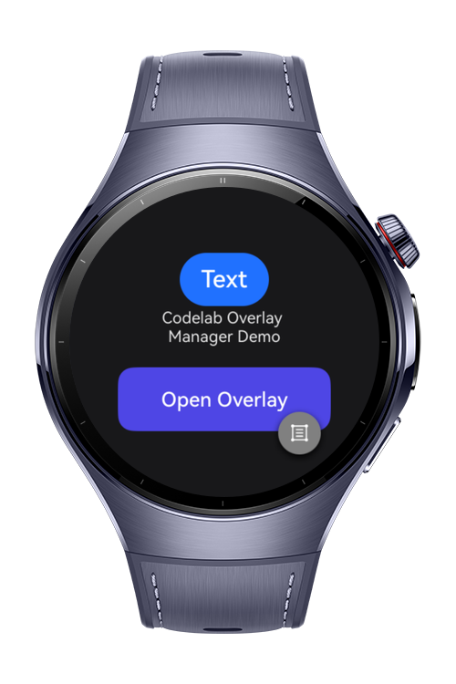
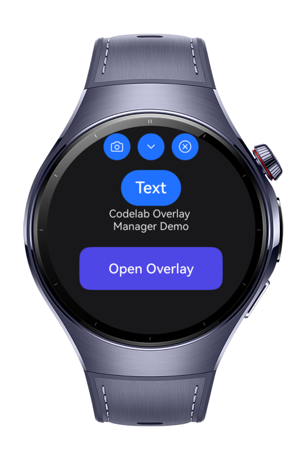
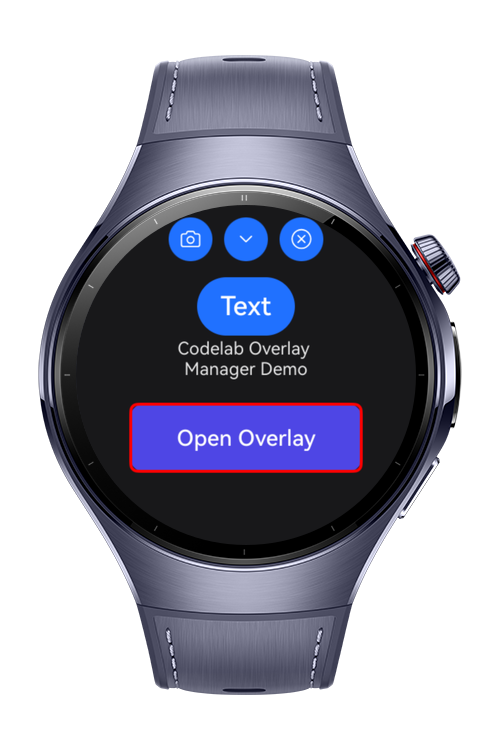
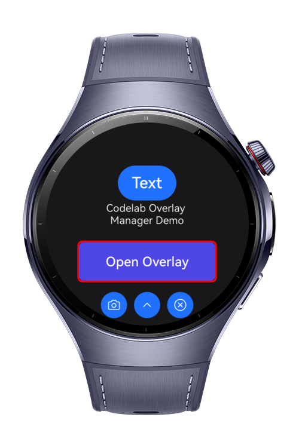

> **Note:** To access all shared projects, get information about environment setup, and view other guides, please visit [Explore-In-HMOS-Wearable Index](https://github.com/Explore-In-HMOS-Wearable/hmos-index).

# How To Build Screen Snapshot Tool

This is a simple application that uses ComponentScreenshot to obtain selected component's screenshots. It uses overlays to display the screenshot options.

# Preview

<p>
  
  
  
  
</p>

# Use Cases

- Get component screenshots
- Create elements with overlay manager

# Tech Stack

- **Languages**: ArkTS, Typescript
- **Frameworks**: HarmonyOS SDK 6.0.1(21)
- **Tools**: DevEco Studio Vers 6.0.2
- **Libraries**: @kit.ImageKit, @kit.CoreFileKit, @kit.AbilityKit

# Directory Structure

```entry/src/main/ets/
|---common
| |---ImageUtils.ets
| |---OverlayManager.ets
|---components
| |---FormatOptions.ets
| |---Highlighter.ets
| |---ScreenshotOverlay.ets
| |---SharingOptions.ets
|---entryability
| |---EntryAbility.ets
|---entrybackupability
| |---EntryBackupAbility.ets  
|---pages
| |---Index.ets 
| |---NavigationContainer.ets 
```

# Constraints and Restrictions
## Supported Devices
- Huawei Watch 5

# LICENSE

Screenshot Overlay is distributed under the terms of the MIT License.
See the [LICENSE](/LICENSE) for more information.
